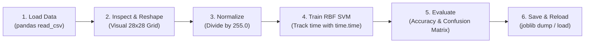

# Project: Handwritten Digit Recognition (SVM)

* **Notebook**: [`mnist_svm.ipynb`](file:///d:/ml_viva/mnist_svm.ipynb)
* **Goal**: Classify handwritten digits ($0$ through $9$) using Support Vector Machines.

---

### 1. Understanding the MNIST Dataset

| Property | Value | Description |
| :--- | :--- | :--- |
| **Training Records** | $60,000$ rows | Stored in [`mnist_train.csv`](file:///d:/ml_viva/mnist_train.csv) |
| **Testing Records** | $10,000$ rows | Stored in [`mnist_test.csv`](file:///d:/ml_viva/mnist_test.csv) |
| **Columns per Row** | $785$ values | $1$ label column $+$ $784$ pixel columns |
| **Target ($y$)** | `label` ($0$ to $9$) | The actual ground truth digit written |
| **Features ($X$)** | `1x1` to `28x28` | $784$ grayscale pixel intensities ($0$ to $255$) |

#### What Does $784$ Signify?
Each digit is a centered grayscale image of **$28 \times 28$ pixels**.
Because classical machine learning algorithms require a 1D tabular vector of features:
$$\text{Total Features} = 28 \text{ rows} \times 28 \text{ columns} = 784 \text{ features}$$
To display an image, we reshape the 1D row back into a 2D matrix:
$$\text{Flattened Row } (784,) \xrightarrow{\text{reshape}(28, 28)} \text{2D Matrix } (28, 28)$$

#### What Do the Pixel Numbers Signify?
* **`0`**: Blank background / white canvas (zero ink).
* **`255`**: Maximum ink intensity (solid black stroke).
* **`1` to `254`**: Intermediate shades of gray representing smooth, anti-aliased handwriting contours.

---

### 2. Workflow & Step-by-Step Implementation



1. **Data Loading**: Read `mnist_train.csv` and `mnist_test.csv` using `pd.read_csv()`.
2. **Feature Separation**: Separate the target `label` ($y$) from the 784 pixel features ($X$).
3. **Visualization**: Reshape sample rows to `(28, 28)` and render them with `plt.imshow(image, cmap='gray')`.
4. **Normalization**: Divide pixel features by `255.0` to rescale all values from $[0, 255]$ into $[0.0, 1.0]$.
5. **Training Subset Configuration**: Use the first $10,000$ samples for training. This reaches **~97.5% accuracy in ~15-20 seconds** on CPU, avoiding the 20-30 minute bottleneck of training on all 60,000 samples.
6. **Model Training**: Train an RBF kernel Support Vector Classifier:
   ```python
   model = SVC(kernel='rbf', C=5.0)
   model.fit(X_train_sub, y_train_sub)
   ```
7. **Elapsed Time Measurement**: Use Python's built-in `time` module (`time.time()`) to track exact training and prediction durations.
8. **Evaluation**:
   * Calculate overall **Test Accuracy** (`accuracy_score`).
   * Output a **Classification Report** detailing Precision, Recall, and F1-score for each digit $0$ to $9$.
   * Plot a **Confusion Matrix Heatmap** to inspect misclassifications (e.g., confusing 4 with 9, or 3 with 5).
   * Visually inspect test predictions with green/red titles.
9. **Model Persistence**: Save the trained model to `svm_mnist_model.joblib` using `joblib.dump()`, and demonstrate reloading it with `joblib.load()` for instant inference.

---

---
